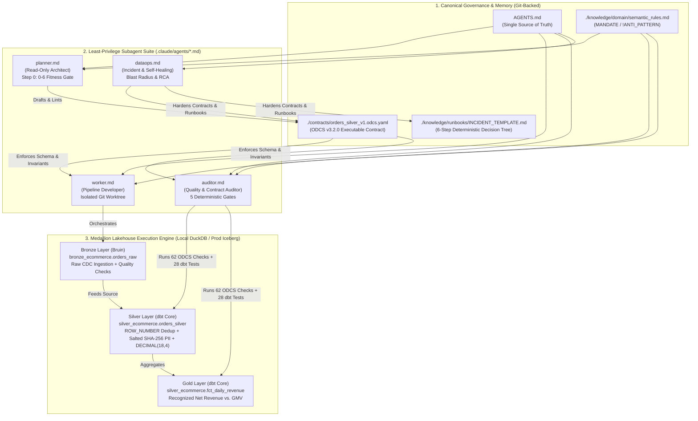

# DE Agentic Boilerplate (OLAP) — Enterprise Multi-Agent Harness for Medallion Data Engineering

[](https://bitol-io.github.io/open-data-contract-standard/v3.2.0/)
[](https://duckdb.org/)
[](https://www.getdbt.com/)
[](https://getbruin.com/)
[-8B5CF6?style=flat-square)](./knowledge/)
[](./AGENTS.md)

An enterprise-grade **Spec-Driven Agentic Data Engineering Boilerplate** designed for building, auditing, and operating **Medallion Lakehouse (OLAP)** pipelines. It combines **executable data contracts (ODCS v3.2.0)**, **Git-versioned institutional memory (OKF)**, **least-privilege Markdown subagents**, and a **sub-second local verification loop (`Bruin` + `dbt Core` + `DuckDB` + `DataContract CLI`)**.

---

## 1. Executive Summary & Architectural Philosophy

Modern AI-assisted data engineering suffers from four systemic failure modes when operated via ad-hoc chat prompts:
1. **Context Drift & Token Exhaustion**: Loading hundreds of MCP tools and raw table schemas into a single monolithic agent saturates the context window, inflates token costs, and degrades reasoning accuracy.
2. **Silent Data Corruption**: Unconstrained code generation frequently introduces **silent `JOIN` fan-outs** (row multiplication when joining header tables with line-item logs), non-idempotent `INSERT` logic, and IEEE 754 floating-point (`FLOAT`) rounding errors in financial columns.
3. **Lack of Segregation of Duties (SoD)**: Allowing the same agent that writes pipeline code to also define and modify quality thresholds creates a perverse incentive to bypass failing tests.
4. **Generative Hallucination During Production Incidents**: Troubleshooting broken production pipelines with open-ended LLM reasoning instead of deterministic runbooks risks destructive unpartitioned re-runs (`--full-refresh`) and downstream SLA breaches.

**`de-agentic-boilerplate-olap` solves these challenges by shifting from Prompt-Driven Coding to Spec-Driven Data Engineering**:
- **Single Source of Truth (`AGENTS.md`)**: A canonical runtime constitution (< 100 lines) imported via lightweight shims (`.claude/CLAUDE.md` and `.gemini/GEMINI.md`) to guarantee zero configuration drift across CLI clients.
- **Executable Data Contracts First (`ODCS v3.2.0`)**: No SQL or PySpark code is written until an Open Data Contract Standard v3.2.0 YAML specification is linted and signed off.
- **Least-Privilege Specialist Subagents (`.claude/agents/*.md`)**: Heavy MCP servers (`datahub`, `bruin`, `dbt`, `elementary-observability`) and filesystem write permissions are strictly isolated per specialist role.
- **Zero-Cost Local Verification Loop**: Every transformation and 62 contract quality assertions execute locally against **DuckDB** in under **4 seconds** before a Pull Request is ever opened.

---

## 2. End-to-End Architecture & Multi-Agent Topology



---

## 3. Chronological Lifecycle of a Pipeline (The 80/90/90 Workflow)

This harness is engineered around a disciplined **Human-in-the-Loop (80% Human Architecture $\rightarrow$ 90% AI Implementation $\rightarrow$ 90% Human Review)** chronological workflow:

```
┌─────────────────────────────────────────────────────────────────────────────────────┐
│ PHASE 0: Pre-Flight Architectural Fitness Gate (Scorecard 0–6 & Circuit Breaker)    │
│ Subagent `planner` evaluates whether the workload fits Medallion OLAP before coding │
└──────────────────────────────────────────┬──────────────────────────────────────────┘
                                           ▼
┌─────────────────────────────────────────────────────────────────────────────────────┐
│ PHASE 1: Specification & Contract Design (80% Human Architect / 20% `planner`)      │
│ Formalize `./contracts/<asset>.odcs.yaml` + `./knowledge/domain/semantic_rules.md`  │
└──────────────────────────────────────────┬──────────────────────────────────────────┘
                                           ▼
┌─────────────────────────────────────────────────────────────────────────────────────┐
│ PHASE 2: Closed-Loop Autonomous Build (90% `worker` / 10% Human Supervision)        │
│ Implement Bruin Bronze + dbt Silver/Gold; self-correct via `make compile` & `build` │
└──────────────────────────────────────────┬──────────────────────────────────────────┘
                                           ▼
┌─────────────────────────────────────────────────────────────────────────────────────┐
│ PHASE 3: Deterministic 5-Gate Audit & Merge (90% Human Reviewer / 10% `auditor`)    │
│ Execute `make contract-test` (62 ODCS checks), inspect `git diff`, issue PASS/BLOCK │
└──────────────────────────────────────────┬──────────────────────────────────────────┘
                                           ▼
┌─────────────────────────────────────────────────────────────────────────────────────┐
│ PHASE 4: Continuous Reliability & Self-Healing (`dataops` Post-Incident Loop)       │
│ Triage anomalies via 6-step runbook and immunize contracts via Git Pull Request     │
└─────────────────────────────────────────────────────────────────────────────────────┘
```

### Phase 0 — Pre-Flight Architectural Fitness Gate (`0–6` Scorecard)
Before generating hundreds of lines of YAML, [`planner.md`](./.claude/agents/planner.md) evaluates the proposed project against **6 Medallion OLAP Fitness Criteria**:
1. **Workload Pattern**: Analytical Batch/Micro-Batch (`OLAP`) vs. Point-Lookup Transactional State (`OLTP`).
2. **Latency SLA**: Scheduled DAG (minutes/hours) vs. Sub-Second Event Streaming.
3. **Data Modality**: Structured/Semi-Structured Tabular vs. Unstructured PDFs/Audio/Vectors.
4. **Volume & Compute Scale**: Single-Node DuckDB (`<100 GB` active working set or sampled dev) vs. Unsampled Multi-TB Joins.
5. **Catalog Dependency**: Local Manifest/Contracts vs. Blocking External Catalog Infrastructure.
6. **Lifecycle Scope**: Recurring Production Asset vs. Disposable One-Off Script.

> **Token-Saving Circuit Breaker**: If a project scores `< 6/6` (for example, an operational web scraper requiring sub-millisecond point lookups), `planner` **halts before generating YAML**, outputs a 12-line diagnostic recommending the appropriate stack adaptation (e.g., swapping `dbt + DuckDB` for `Python + SQLite WAL`), and awaits human confirmation.

### Phase 1 — Human-Led Architecture & Executable Contracts (`80% Human`)
Instead of chatting back-and-forth across 20 prompts, architectural decisions are crystallized in two versioned files:
- [`./contracts/orders_silver_v1.odcs.yaml`](./contracts/orders_silver_v1.odcs.yaml): Defines physical column types (`DECIMAL(18,4)`, `VARCHAR(64)`), primary keys (`order_id`), `semanticType` (`dimension` | `measure`), SLAs, and the native ODCS v3.2.0 `context` block (`instructions`, `verifiedStatements`, `constraints`).
- [`./knowledge/domain/semantic_rules.md`](./knowledge/domain/semantic_rules.md): Encodes domain invariants using paired **`MANDATE:`** and **`!ANTI_PATTERN:`** statements (reducing LLM logical violations by >95%).

### Phase 2 — Closed-Loop Implementation (`90% AI Worker`)
Dispatched via a concise 12-line pointer prompt, [`worker.md`](./.claude/agents/worker.md) operates in an isolated Git worktree:
- Governs **Bronze raw ingestion** via **Bruin** ([`pipelines/assets/bronze_orders.sql`](./pipelines/assets/bronze_orders.sql)).
- Governs **Silver and Gold analytical transformations** via **dbt Core** ([`orders_silver.sql`](./dbt_project/models/silver/orders_silver.sql), [`fct_daily_revenue.sql`](./dbt_project/models/gold/fct_daily_revenue.sql)).
- Runs `make compile` (`dbt compile --select state:modified+`) in **0.2 seconds**. If any SQL syntax or schema contract discrepancy arises, the worker reads `stdout`, fixes the model autonomously, and re-runs until all 28 dbt tests pass.

### Phase 3 — Deterministic 5-Gate Audit (`auditor` + `90% Human Review`)
[`auditor.md`](./.claude/agents/auditor.md) operates with strict **Read-Only** permissions (`Write` and `Edit` are disabled) and verifies five mandatory gates:
- **Gate 1 (ODCS v3.2.0 Compliance)**: Runs `make contract-lint` and `make contract-test` (62 live SQL checks against DuckDB).
- **Gate 2 (Silent JOIN Fan-Out Prevention)**: Verifies `duplicateValues == 0` on `order_id` and enforces pre-aggregating CTEs before joining child tables.
- **Gate 3 (Financial Precision)**: Enforces `DECIMAL(18,4)` and verifies the accounting reconciliation identity:
  $$\text{net\_order\_amount} = \text{gross\_order\_amount} - \text{discount\_amount} + \text{tax\_amount} + \text{shipping\_amount}$$
- **Gate 4 (Idempotency & Partition Pruning)**: Verifies deterministic CDC deduplication (`ROW_NUMBER() OVER (...) = 1`) and `order_date` partition filters.
- **Gate 5 (PII Governance)**: Confirms salted `SHA-256` hashing on `customer_email_hash` and `customer_tax_id_hash`.

### Phase 4 — Post-Incident Triage & Self-Healing (`dataops`)
When production anomalies occur, [`dataops.md`](./.claude/agents/dataops.md) follows the deterministic 6-step decision tree in [`./knowledge/runbooks/INCIDENT_TEMPLATE.md`](./knowledge/runbooks/INCIDENT_TEMPLATE.md) and executes [`./skills/post-incident-learn.md`](./skills/post-incident-learn.md) to convert every root cause into a new permanent contract assertion via Pull Request.

---

## 4. Least-Privilege Subagent Matrix & MCP Scoping

| Specialist Subagent | Definition File | Scoped MCP Servers | Allowed Execution Tools | Explicitly Disallowed Tools | Git Isolation |
| :--- | :--- | :--- | :--- | :--- | :--- |
| **`data-architecture-planner`** | [`.claude/agents/planner.md`](./.claude/agents/planner.md) | `datahub` | `Read`, `Grep`, `Glob`, `rg`, `datacontract:lint` | `Write`, `Edit`, `MultiEdit`, `dbt:run`, `bruin:run` | `none` |
| **`pipeline-developer-worker`** | [`.claude/agents/worker.md`](./.claude/agents/worker.md) | `bruin`, `dbt` | `Read`, `Write`, `Edit`, `Grep`, `bruin:*`, `dbt:*`, `make:*` | `rm -rf`, `git push --force`, `dbt:run --full-refresh` | `worktree` |
| **`data-quality-auditor`** | [`.claude/agents/auditor.md`](./.claude/agents/auditor.md) | `elementary-observability`, `datahub` | `Read`, `Grep`, `datacontract:test`, `bruin:validate`, `dbt:test`, `edr:*` | `Write`, `Edit`, `MultiEdit`, `dbt:run`, `bruin:run` | `worktree` |
| **`dataops-incident-triage`** | [`.claude/agents/dataops.md`](./.claude/agents/dataops.md) | `elementary-observability`, `datahub` | `Read`, `Write`/`Edit` *(restricted to `./knowledge/`, `./skills/`, `./contracts/`)* | `DROP`, `TRUNCATE`, `dbt:run --full-refresh` | `worktree` |

---

## 5. Why dbt Core + DuckDB in an Agentic Medallion Lakehouse?

| Architectural Vector | Imperative PySpark Scripts (Without dbt) | Declarative dbt Core + DuckDB/Iceberg (This Boilerplate) |
| :--- | :--- | :--- |
| **LLM Token Consumption** | High: LLM must read/generate `SparkSession` boilerplate, imperative `.withColumn()` chains, and manual write modes. | **Reduced by >60%**: Agent writes pure declarative `SELECT` statements with `{{ ref() }}`; DDL/DML is handled by dbt. |
| **DAG & Lineage Discovery** | Slow: Agent must grep across dozens of `.py` files to infer upstream/downstream dependencies. | **Instant (`manifest.json`)**: Compiled `target/manifest.json` exposes the entire typed DAG, column contracts, and lineage in milliseconds. |
| **State-Aware Selective Builds** | Manual: Requires custom orchestrator logic to avoid re-running unchanged upstream tables. | **Native (`--select state:modified+ --defer`)**: Compiles and builds only modified models and their downstream dependents against `./target/prod_manifest`. |
| **Local Compiler Feedback Loop** | Slow: Requires spinning up a JVM Spark context (15–45 seconds) to catch a simple SQL typo. | **Sub-Second (`0.2s` Compile / `0.95s` Build)**: Immediate deterministic terminal feedback against local DuckDB. |

---

## 6. Repository Structure

```text
de-agentic-boilerplate-olap/
├── AGENTS.md                                      # Canonical runtime instructions (< 100 lines)
├── Makefile                                       # Deterministic CLI shortcuts (setup, ingest, build, contract-test)
├── pyproject.toml                                 # Python 3.12 dependency specification (dbt, duckdb, datacontract-cli)
├── .env.example                                   # Environment variable template (salts, paths, MCP endpoints)
├── .bruin.yml                                     # Bruin local DuckDB environment configuration
├── .github/
│   └── workflows/
│       └── ci.yml                                 # Automated GitHub Actions CI gate (Bruin + dbt + 62 ODCS checks)
├── .agents/
│   └── mcp_config.json                            # Declarative MCP registry (datahub, bruin, dbt, elementary)
├── .claude/
│   ├── CLAUDE.md                                  # Lightweight Claude Code shim (@AGENTS.md)
│   └── agents/
│       ├── planner.md                             # Architect & Pre-Flight Fitness Evaluator (Read-Only)
│       ├── worker.md                              # Medallion Pipeline Developer (Bruin Bronze + dbt Silver/Gold)
│       ├── auditor.md                             # 5-Gate Contract & Quality Auditor (Read-Only)
│       └── dataops.md                             # Incident Triage & Self-Healing Specialist
├── .gemini/
│   └── GEMINI.md                                  # Lightweight Gemini CLI / Antigravity shim (@AGENTS.md)
├── contracts/
│   └── orders_silver_v1.odcs.yaml                 # Executable ODCS v3.2.0 Data Contract (62 automated checks)
├── knowledge/
│   ├── domain/
│   │   └── semantic_rules.md                      # Open Knowledge Format (OKF) FinOps & E-commerce rules
│   └── runbooks/
│       └── INCIDENT_TEMPLATE.md                   # P0-P3 Severity Matrix & 6-Step Deterministic Decision Tree
├── skills/
│   ├── grilling-architecture.md                   # Pre-code architectural alignment interview skill
│   └── post-incident-learn.md                     # Post-mortem contract & runbook immunization skill
├── pipelines/
│   ├── pipeline.yml                               # Bruin DAG schedule & default connections
│   └── assets/
│       └── bronze_orders.sql                      # Bronze raw CDC ingestion asset + 4 embedded checks
└── dbt_project/
    ├── dbt_project.yml                            # dbt configuration & PII salt variable definitions
    ├── profiles.yml                               # Local DuckDB connection profile (silver_ecommerce)
    └── models/
        ├── sources.yml                            # Bronze source declarations
        ├── silver/
        │   ├── orders_silver.sql                  # CDC deduplication, SHA-256 PII hashing & DECIMAL(18,4) reconciliation
        │   └── schema.yml                         # Enforced dbt model contract & 26 column/domain tests
        └── gold/
            └── fct_daily_revenue.sql              # Official Recognized Net Revenue vs. GMV aggregation
```

---

## 7. Quickstart & Deterministic CLI Reference

### Prerequisites
- Linux / macOS with Python `3.12`, [`uv`](https://docs.astral.sh/uv/), and [`bruin`](https://getbruin.com/).

### Run the Full Medallion Pipeline & Contract Audit in 1 Command
```bash
# Synchronize Python environment (.venv)
make setup

# Run Bronze ingestion (Bruin) -> Silver/Gold build (dbt) -> ODCS v3.2.0 verification (62 checks)
make all
```

### Granular Command Reference & Real Telemetry Benchmarks

| Make Target | Underlying CLI Command | Purpose | Verified Local Runtime |
| :--- | :--- | :--- | :--- |
| `make setup` | `uv sync` | Installs locked dependencies into `.venv` | `~0.40s` (cached) |
| `make ingest` | `bruin validate && bruin run ./pipelines/` | Materializes `bronze_ecommerce.orders_raw` + 4 checks | **`21ms`** (4/4 PASS) |
| `make build` | `dbt build --project-dir ./dbt_project` | Builds `orders_silver` & `fct_daily_revenue` + 26 tests | **`0.95s`** (28/28 PASS) |
| `make init-state` | `cp dbt_project/target/manifest.json target/prod_manifest/` | Updates canonical baseline manifest for state comparison | `<10ms` |
| `make compile` | `dbt compile --select state:modified+ --state ...` | Zero-cost syntax & contract compilation of modified nodes | **`0.25s`** |
| `make build-modified` | `dbt build --select state:modified+ --defer --state ...` | Selective incremental build deferring unchanged upstream models | **`0.45s`** |
| `make contract-lint` | `datacontract lint ./contracts/orders_silver_v1.odcs.yaml` | Validates contract against official ODCS v3.2.0 JSON Schema | **`0.23s`** (1/1 PASS) |
| `make contract-test` | `datacontract test ... --server local_duckdb` | Executes 62 schema, uniqueness, freshness, and FinOps SQL checks | **`1.06s`** (62/62 PASS) |

---

## 8. Architectural Boundaries & Falsifiability Matrix (When to Adapt)

While the **Agentic Governance Layer (`AGENTS.md`, Subagents, ODCS v3.2.0 Contracts, OKF Knowledge)** is universal, the **Physical Execution Stack (`Bruin + dbt Core + DuckDB`)** is purpose-built for **Batch/Micro-Batch Analytical Lakehouses (OLAP)**. Use the matrix below (enforced automatically by `planner.md` Step 0) to select the right profile for your workload:

| Architectural Profile | Target Workload Characteristics | What Stays from Boilerplate | What Changes in Physical Stack |
| :--- | :--- | :--- | :--- |
| **Profile 1: Lean App / State-Driven CDC** *(e.g., B2B Price Monitors, Alerting Bots)* | High-frequency single-SKU point lookups, state hash comparison, transactional outbox queues (`OLTP`). | `AGENTS.md`, `planner/worker/auditor`, `ODCS v3.2.0` contracts, `semantic_rules.md`, `Makefile`, `uv`. | **Remove `dbt Core` & `DuckDB`** $\rightarrow$ **Use Python + `SQLite (WAL Mode)` + `Pydantic` Shift-Left validation**. |
| **Profile 2: Medallion OLAP Pro (Default)** *(e.g., E-commerce FinOps, Comex Trade Lakehouse, MacroFlow)* | Multi-table analytical aggregations, historical star schemas, financial reconciliation (`<100 GB` active working set). | **100% of this repository out-of-the-box** (`Bruin` + `dbt Core` + `DuckDB / Parquet / Iceberg` + `ODCS v3.2.0`). | None — native sweet spot. |
| **Profile 3: Distributed Cloud Lakehouse** *(e.g., Multi-TB Enterprise Data Platform)* | Partitioned tables exceeding single-node RAM/NVMe (`>200 GB` to Petabytes) with enterprise catalog governance. | 100% of the codebase, contracts, subagents, and local DuckDB CI sampling. | Point production `profiles.yml` and `servers` to **Databricks (Unity Catalog)**, **Snowflake**, or **BigQuery** and enable live `datahub` MCP. |
