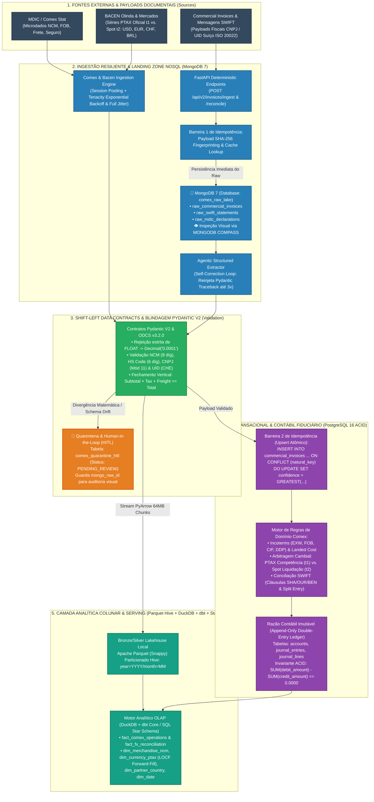

# 🚢 Relatório de Arquitetura de Dados (RAW) — Comex Resilient Data & Fiduciary Engine V2

> 🏠 **Hub do Projeto**: [[00 - Comex Data Engine V2|Voltar ao Hub Comex Data Engine V2]] | 🏛️ **Harness Agêntico**: [[00 - DE Agentic Boilerplate OLAP|Hub DE Agentic Boilerplate]] | 💼 **Playbook Portfólio**: [[01_Portfolio_Proof_Of_Work_READMEs|Tríade de Repositórios B2B]] | 📁 **Repositório V1/V2**: `file:///home/Hugo/end-to-end-comex-data-pipeline` | 📁 **Workspace Boilerplate V2**: `file:///home/Hugo/comex-data-engine-v2`

---

## 1. Paradigm Shift: Do ETL Aduaneiro Isolado ao Motor Híbrido Fiduciário & Analítico (HTAP)

Na engenharia de dados aplicada ao Comércio Exterior (**COMEX**) e à contabilidade fiduciária internacional, pipelines tradicionais falham em duas frentes opostas:
1. **Sistemas Puramente Analíticos (Batch ETL Clássico)**: Baixam arquivos CSV/Parquet brutos de comércio exterior (MDIC / Comex Stat) sem rigor transacional, utilizando aritmética de ponto flutuante (`float` IEEE 754) que corrompe conciliações cambiais por frações de centavo, e ignoram o ciclo de vida contábil das faturas comerciais (*Commercial Invoices*).
2. **Sistemas Puramente Transacionais (ERP/CRUD Isolado)**: Registram documentos fiscais sem capacidade de processamento analítico colunar sobre milhões de linhas históricas de NCMs, fretes internacionais e séries temporais de câmbio (**PTAX / BACEN**), além de sobrescreverem saldos com instruções destrutivas (`UPDATE balance = ...`) que destroem a trilha de auditoria (*Audit Trail*).

O **Comex Data Engine V2** supera essa dicotomia implementando uma arquitetura **Hybrid Transactional/Analytical Processing (HTAP) & Fiduciary Medallion**, combinando o **Core Transacional ACID em PostgreSQL 16** (Idempotência Dupla, Razão Contábil por Partidas Dobradas Imutável, Conciliação Cambial Multi-Moeda e Fila Human-in-the-Loop) com o **Core Analítico Colunar em Apache Parquet + DuckDB + dbt Core** (Star Schema Kimball, Partition Pruning no padrão Hive e inteligência mercantil de *Landed Cost*).

| Dimensão Arquitetural | Pipeline Comex Convencional (V1 / Legado) | Comex Resilient Data & Fiduciary Engine (V2) |
| :--- | :--- | :--- |
| **Escopo de Dados** | Apenas CSVs agregados do MDIC em disco | **Dual-Workload**: Microdados MDIC + Séries Cambiais (PTAX/Spot) + *Commercial Invoices* & Liquidação SWIFT |
| **Aritmética Monetária** | Ponto flutuante binário (`float` / `double` IEEE 754) | **Blindagem Decimal Estrita**: `decimal.Decimal` quantizado no Python/Pydantic, `NUMERIC(19,4)` no PostgreSQL e `BIGINT` (centavos) |
| **Garantia de Idempotência** | Sobrescrita simples de arquivo por data | **Barreira Dupla ($f(f(x)) = f(x)$)**: Hash `SHA-256` do payload bruto na borda + `UNIQUE CONSTRAINT` semântica com `ON CONFLICT DO UPDATE` |
| **Escrituração Financeira** | Inexistente ou atualização destrutiva de coluna | **Append-Only Double-Entry Ledger**: Partidas dobradas com invariante $\sum \text{Débitos} - \sum \text{Créditos} = 0$ e estornos (*Reversal Entries*) |
| **Resiliência de Rede & IA** | Retry simples de conexão HTTP | **Exponential Backoff + Full Jitter** (`tenacity`) para rede + **Agentic Self-Correction Loop** reinjetando `ValidationError` em extrações estruturadas |
| **Governança de Exceções** | Falha ruidosa do script (`exit(1)`) ou descarte silencioso | **Shift-Left Quarantine & HITL**: Divergências aritméticas ou de Incoterms desviadas para fila `human_review_quarantine` |
| **Motor de Armazenamento** | Arquivos Parquet soltos | **Multi-Model HTAP**: **MongoDB 7** (Landing Zone NoSQL de Payloads Brutos) + **PostgreSQL 16** (Estado Transacional, Ledger & Star Schema) + **Apache Parquet Hive + DuckDB** (OLAP Histórico) |

---

## 2. Diagrama de Arquitetura e Linhagem de Dados Ponta a Ponta

A arquitetura divide-se em **5 Camadas Desacopladas**, governadas por contratos executáveis **ODCS v3.2.0** e expostas tanto via **CLI determinística (`Makefile`)** quanto via **API RESTful em FastAPI**:



---

## 3. Especificação Profunda dos Pilares de Engenharia

### 3.0 Pilar 0: Landing Zone NoSQL em MongoDB 7 & Inspeção Visual com MongoDB Compass

A inclusão do **MongoDB 7** como banco orientado a documentos resolve um desafio prático de engenharia que bancos puramente relacionais tratam com dificuldade: **a absorção de payloads externos semi-estruturados com schema-on-read e rastreabilidade visual**:

1. **Por Que NoSQL no Landing de Invoices e SWIFT?**:
   Faturas internacionais (*Commercial Invoices*) de diferentes países e fornecedores variam amplamente em layouts JSON/XML: novos campos de impostos locais, descontos comerciais condicionais e árvores aninhadas de itens de linha. Tentar forçar um schema relacional estrito antes de salvar o documento bruto resulta em perda de dados (*Data Truncation*) ou falhas na ingestão.
   - O documento bruto é salvo imediatamente na coleção `raw_commercial_invoices` ou `raw_swift_statements` no MongoDB com seu `payload_hash` SHA-256 e metadata de recepção.
   - O endpoint responde `HTTP 201 Created` retornando o `raw_id` gerado pelo Mongo.
2. **Inspeção Táctil com MongoDB Compass**:
   Em vez de você operar no escuro via terminal, você abre o **MongoDB Compass** na sua máquina conectando em `mongodb://localhost:27017`:
   - Banco de Dados: `comex_raw_lake`.
   - Coleções:
     - `raw_commercial_invoices`: visualize a árvore JSON completa da fatura, atributos de cabeçalho, arrays de itens e tags fiscais.
     - `raw_swift_statements`: inspecione mensagens bancárias internacionais completas (códigos MT103 ou ISO 20022 `camt.053`) com as deduções de tarifas SWIFT.
     - `raw_mdic_declarations`: payloads brutos de importação e exportação.
   - O Compass permite filtrar por queries visuais (ex: `{ "currency": "CHF", "incoterm": "FOB" }`) e inspecionar a tipagem dos dados antes da normalização contábil.
3. **Ponte Desacoplada MongoDB $\rightarrow$ Pydantic $\rightarrow$ PostgreSQL**:
   O pipeline de extração e validação lê o documento bruto da coleção do MongoDB via `mongo_raw_id`, submete o payload ao contrato **Pydantic V2** (rejeitando `float`, validando Incoterms e equilíbrio vertical) e grava a versão tipada e auditada no **PostgreSQL 16**. Se o documento falhar na validação, a tabela `comex_quarantine_hitl` guarda a referência `mongo_raw_id`, permitindo que o auditor humano abra o MongoDB Compass e compare o JSON original com o erro reportado.

---

### 3.1 Pilar 1: Ingestão Resiliente, Exponential Backoff com Full Jitter e Self-Correction Loop

A camada de ingestão de dados (*Data Ingestion*) lida tanto com APIs governamentais instáveis (MDIC e Olinda/BACEN) quanto com serviços de extração documental estruturada:

1. **Prevenção de *Thundering Herd* em Chamadas de Rede (`tenacity`)**:
   Quando múltiplos workers sofrem *Rate Limiting* (`HTTP 429 Too Many Requests`) ou indisponibilidade temporária (`HTTP 502`, `503`, `504`), retentativas em intervalo fixo causam colisões sincronizadas. O cliente HTTP implementa o algoritmo de **Exponential Backoff com Full Jitter**:
   $$T_{\text{temp}}(n) = \min\left(T_{\text{max}}, \, T_{\text{base}} \cdot 2^n\right), \quad T_{\text{sleep}}(n) \sim \mathcal{U}\left(0, \, T_{\text{temp}}(n)\right)$$
   Onde $T_{\text{base}} = 1.0\text{s}$ e $T_{\text{max}} = 60.0\text{s}$.
2. **Discriminação Estrita de Erros (Transitórios vs. Permanentes)**:
   - **Erros Transitórios (`HTTP 429, 500, 502, 503, 504`, `Timeout`, `ConnectionError`)**: Acionam o decorador `@retry` com Full Jitter.
   - **Erros de Cliente/Semânticos (`HTTP 400, 401, 403, 422`)**: Comportamento *Fail-Fast* imediato (zero retentativa de rede).
3. **Agentic Self-Correction Loop (Validação de Extração Documental)**:
   Quando um payload de *Commercial Invoice* extraído por um modelo de linguagem (ou simulador de extração) falha na validação do contrato Pydantic (`ValidationError`), o sistema **jamais realiza retry cego** enviando o mesmo prompt. O orquestrador captura a árvore estruturada de erros (`err.errors()`), injeta o diagnóstico exato do campo divergente no contexto da próxima tentativa (máximo de 3 iterações) e, caso persista a falha, roteia o documento para a fila **Human-in-the-Loop (`comex_quarantine_hitl`)**.

---

### 3.2 Pilar 2: Idempotência Dupla ($f(f(x)) = f(x)$) no PostgreSQL 16 e no Lakehouse

Para impedir que reprocessamentos de rede, webhooks duplicados ou *backfills* históricos gerem duplicidade financeira ou inflacionem volumes de importação/exportação, a idempotência é garantida em três níveis:

1. **Nível 1 — Idempotência de Borda por Hash Binário (`file_sha256`)**:
   Na chegada de qualquer arquivo ou payload bruto no endpoint FastAPI ou coletor, calcula-se `SHA-256(raw_bytes)`. Se o hash já constar na tabela `ingestion_idempotency_registry` com status `PROCESSED`, a requisição retorna o resultado consolidado em $O(1)$ sem reexecutar parsers ou modelos.
2. **Nível 2 — Idempotência Semântica Relacional (`UNIQUE CONSTRAINT` + Atomic Upsert)**:
   Mesmo que dois arquivos fisicamente distintos representem o mesmo fato gerador (ex: PDF reescaneado da mesma *Commercial Invoice*), a tabela `commercial_invoices` impõe a chave natural composta:
   $$\text{Natural Key} = (\text{issuer\_tax\_id}, \, \text{document\_number}, \, \text{issue\_date}, \, \text{currency\_code}, \, \text{total\_amount})$$
   A escrita utiliza resolução atômica de conflito preservando a maior confiabilidade:
   ```sql
   INSERT INTO commercial_invoices (
       invoice_id, issuer_tax_id, document_number, issue_date, currency_code,
       subtotal_amount, tax_amount, freight_amount, insurance_amount, total_amount,
       incoterm, extraction_confidence, raw_payload_hash, updated_at
   ) VALUES (...)
   ON CONFLICT (issuer_tax_id, document_number, issue_date, currency_code, total_amount)
   DO UPDATE SET
       extraction_confidence = GREATEST(commercial_invoices.extraction_confidence, EXCLUDED.extraction_confidence),
       updated_at = CURRENT_TIMESTAMP;
   ```
3. **Nível 3 — Idempotência Analítica de Operações Aduaneiras (`operation_hash_id`)**:
   Na tabela fato `fact_comex_operations`, cada registro estatístico do MDIC recebe uma chave determinística:
   $$\text{operation\_hash\_id} = \text{SHA-256}(\text{ano} \parallel \text{mes} \parallel \text{tipo\_op} \parallel \text{co\_ncm} \parallel \text{co\_pais} \parallel \text{sg\_uf} \parallel \text{co\_via} \parallel \text{co\_urf})$$
   Garantindo que cargas repetidas via `INSERT ... ON CONFLICT (operation_hash_id) DO UPDATE` ou `MERGE INTO` no DuckDB/dbt sejam 100% idempotentes.

---

### 3.3 Pilar 3: Blindagem Monetária (`Decimal` vs. IEEE 754) e Contratos de Dados (ODCS v3.2.0 + Pydantic V2)

Em sistemas fiduciários e aduaneiros, o uso de `float` binário é estritamente proibido ($0.1 + 0.2 = 0.30000000000000004$), pois causa quebras de centavos na conversão cambial e no rateio de frete/seguro.

1. **Regras do Contrato Pydantic V2 (`src/validation/schemas.py`)**:
   - **`@field_validator` Anti-Float**: Qualquer instância do tipo `float` recebida em campos monetários ou de taxa de câmbio dispara `ValueError("IEEE 754 float is strictly prohibited for monetary fields; pass str, int, or Decimal")`. Todos os valores são convertidos e quantizados em `Decimal("0.0001")` (`NUMERIC(19,4)`) com arredondamento explícito `ROUND_HALF_UP`, além de espelhamento em centavos inteiros (`BIGINT`).
   - **Validação Aritmética Horizontal (`verify_line_math`)**: Em cada item da fatura (`CommercialInvoiceLine`), valida-se:
     $$\text{ROUND}(\text{quantity} \times \text{unit\_price}, 4) == \text{line\_total}$$
   - **Fechamento Vertical da Fatura e Regras de Incoterms (`validate_invoice_balance`)**:
     - Soma dos itens deve igualar exatamente o `subtotal_amount`.
     - Fechamento vertical obrigatório:
       $$\text{subtotal\_amount} + \text{tax\_amount} + \text{freight\_amount} + \text{insurance\_amount} == \text{total\_amount}$$
     - **Validação Semântica de Incoterm**:
       - Se `incoterm IN ('EXW', 'FOB')`, a fatura de mercadoria na origem não pode embutir frete marítimo internacional sem destaque explícito; o custo total de estoque (*Landed Cost*) aguarda a agregação do Conhecimento de Embarque (*Bill of Lading* — BL).
       - Se `incoterm == 'CIF'`, o contrato exige a segregação das rubricas de `freight_amount` e `insurance_amount` para tributação aduaneira correta (cálculo do Valor Aduaneiro).
   - **Validação Fiscal Transnacional**:
     - **Mercadorias**: `hs_code` validado por Regex `^\d{6}$` (Sistema Harmonizado Internacional) e `ncm_code` por `^\d{8}$` (Nomenclatura Comum do Mercosul).
     - **Identificadores Fiscais**: Validação algorítmica de **CNPJ brasileiro** (14 dígitos com cálculo dos dígitos verificadores em Módulo 11) e validação de **UID Suíço** no padrão oficial `^CHE-\d{3}\.\d{3}\.\d{3}(\s?(MWST|TVA|IVA))?$`.
     - **Moedas Suportadas**: Enum restrito `CurrencyCode` (`CHF`, `EUR`, `USD`, `BRL`).

---

### 3.4 Pilar 4: Razão Contábil por Partidas Dobradas (Double-Entry Bookkeeping) em PostgreSQL

Para atender aos requisitos de auditoria fiduciária internacional, toda movimentação financeira validada (emissão de *Commercial Invoice*, reconhecimento de frete/impostos e liquidação bancária) é escriturada em um motor de **Partidas Dobradas Imutável (*Append-Only Ledger*)**:

1. **Estrutura Relacional do Ledger**:
   - `accounts`: Plano de contas (*Chart of Accounts*) classificado por natureza (`ASSET`, `LIABILITY`, `EQUITY`, `REVENUE`, `EXPENSE`).
   - `journal_entries`: Cabeçalho do lançamento contábil contendo `entry_id` (UUID), `transaction_date`, `competence_date`, `reference_document_id`, `status` (`POSTED`, `REVERSED`), `reversed_from_entry_id` e `created_at`.
   - `journal_lines`: Linhas individuais do lançamento contendo `line_id`, `entry_id`, `account_code`, `debit_amount` (`NUMERIC(19,4)`), `credit_amount` (`NUMERIC(19,4)`), `currency_code`, `original_currency_amount` e `exchange_rate_applied`.
2. **Invariante Fundamental de Soma Zero**:
   Nenhuma transação contábil pode ser persistida a menos que contenha no mínimo 2 linhas (pelo menos um débito e um crédito) e satisfaça estritamente a equação de equilíbrio em moeda funcional (`BRL` ou `CHF`):
   $$\sum_{i=1}^{k} \text{debit\_amount}_i - \sum_{j=1}^{m} \text{credit\_amount}_j = 0.0000$$
3. **Imutabilidade (`Append-Only`) & Fluxo de Estorno (`Reversal Entries`)**:
   - Triggers e permissões de banco bloqueiam qualquer `UPDATE` ou `DELETE` em registros com `status = 'POSTED'` nas tabelas `journal_entries` e `journal_lines`.
   - Correções operacionais são realizadas exclusivamente via chamada de **Estorno Contábil (`create_reversal_entry`)**, que gera um novo `journal_entry` espelhado invertendo Débitos e Créditos (`debit_amount <-> credit_amount`), referenciando o lançamento original em `reversed_from_entry_id`, preservando 100% do *Audit Trail*.

---

### 3.5 Pilar 5: Conciliação Cambial Multi-Moeda (PTAX vs. Spot), Séries Temporais (LOCF) e Tarifas SWIFT

O projeto resolve três problemas reais de finanças internacionais e comércio exterior:

1. **Imputação Temporal Sem *Lookahead Bias* (LOCF / Forward-Fill na `dim_currency_ptax`)**:
   O Banco Central (Olinda) e a administração federal suíça (ESTV) não publicam cotações em sábados, domingos ou feriados, mas embarques aduaneiros e emissões de *Invoices* ocorrem 365 dias por ano. O pipeline constrói o calendário contínuo aplicando estritamente **Last Observation Carried Forward (LOCF / Forward-Fill)** — atribuindo a cotação de fechamento do último dia útil imediatamente anterior e marcando a flag `is_interpolated = TRUE`. O preenchimento retroativo (*Backfill* com datas futuras) é bloqueado por contrato para evitar fraude fiscal e *lookahead bias*.
2. **Cálculo Determinístico de Variação Cambial ($\Delta_{\text{Cambial}}$)**:
   Toda *Commercial Invoice* em moeda estrangeira ($V_{\text{estrang}}$ em `USD`, `EUR` ou `CHF`) atravessa dois momentos:
   - **Data de Competência ($t_1$ — Emissão/Desembaraço)**: Convertida pela Taxa Oficial ($\text{Taxa}_{\text{PTAX}}(t_1)$), gerando o reconhecimento em Contas a Pagar/Receber:
     $$V_{\text{competência}} = \text{ROUND}\left(V_{\text{estrang}} \times \text{Taxa}_{\text{PTAX}}(t_1), \, 4\right)$$
   - **Data de Liquidação ($t_2$ — Fechamento de Câmbio / Caixa)**: Liquidada pelo banco comercial pela Taxa Spot efetiva ($\text{Taxa}_{\text{Spot}}(t_2)$):
     $$V_{\text{liquidação}} = \text{ROUND}\left(V_{\text{estrang}} \times \text{Taxa}_{\text{Spot}}(t_2), \, 4\right)$$
   - **Apuração de Variação Cambial Ativa / Passiva**:
     $$\Delta_{\text{Cambial}} = V_{\text{estrang}} \times \left(\text{Taxa}_{\text{Spot}}(t_2) - \text{Taxa}_{\text{PTAX}}(t_1)\right)$$
     O motor baixa 100% do valor original de $V_{\text{competência}}$, registra a saída/entrada real de caixa $V_{\text{liquidação}}$ e lança automaticamente a diferença $\Delta_{\text{Cambial}}$ na conta de **Variação Cambial Ativa (`REALIZED_FX_GAIN`)** ou **Variação Cambial Passiva (`REALIZED_FX_LOSS`)**, segregando o IOF quando aplicável.
3. **Motor de Conciliação Bancária Internacional & Tarifas SWIFT (2 Estágios)**:
   - **Estágio 1 (Pareamento Determinístico)**: Busca exata pelo identificador `end_to_end_id` (padrão ISO 20022 `camt.053`) ou número da fatura referenciado na mensagem bancária.
   - **Estágio 2 (Pareamento Heurístico com Janela de Tolerância SWIFT)**: Quando bancos correspondentes retêm tarifas intermediárias na rede SWIFT (cláusulas `SHA`, `OUR` ou `BEN`, tipicamente entre $10.00$ e $50.00$ unidades da moeda original) dentro de uma janela de $\pm 5$ dias úteis do vencimento (`Net 30`, `2/10 Net 30`), o motor identifica a dedução e gera automaticamente um **Split Journal Entry (Partida Dobrada Composta)**:
     - **Recebimento de Exportação**: Débito em `Banco Conta Movimento` (valor líquido recebido) + Débito em `Despesas Bancárias SWIFT` (tarifa retida) = Crédito em `Clientes no Exterior` (valor nominal integral da fatura).

---

## 4. Decisões Arquiteturais & Matriz de Trade-offs (ADRs)

**Status:** Approved | **Domain:** Comex Analytics & International Fiduciary Engineering (Tier 2 Core Business)

### 4.1 Matriz de Trade-offs entre Vetores Arquiteturais

| Vetor de Decisão | Option A: Abordagem Ingênua (Anti-Pattern) | Option B: Over-Engineering Distribuído (Cloud Heavy) | Option C: Arquitetura Selecionada (Hybrid HTAP & Fiduciary Medallion) |
| :--- | :--- | :--- | :--- |
| **1. Armazenamento & Persistência** | Apenas CSVs/Parquets locais sem banco relacional ou apenas SQLite sem suporte a concorrência de rede e tipos `NUMERIC` estritos. | Cluster Spark/Databricks + Cloud Data Warehouse pago 24/7 para dados que cabem em memória/SSD local. | **PostgreSQL 16 (Docker)** para transações ACID, Upsert e Double-Entry Ledger + **Parquet Hive & DuckDB/dbt** para OLAP vetorial de alta velocidade. |
| **2. Representação Monetária** | Tipo `float` nativo do Python e `REAL`/`DOUBLE PRECISION` no banco de dados. | Biblioteca externa pesada de computação simbólica. | **`decimal.Decimal` (Python/Pydantic)** + **`NUMERIC(19,4)` (PostgreSQL/DuckDB)** + **`BIGINT` (Centavos)** validados por contrato ODCS v3.2.0. |
| **3. Conciliação Cambial & SWIFT** | Comparar valor faturado e valor liquidado com `==`; falhar toda conciliação quando houver variação cambial ou tarifa SWIFT. | Regras manuais ad-hoc em planilhas fora do pipeline. | **Motor de Conciliação em 2 Estágios**: Separação temporal Competência ($t_1$ PTAX) vs. Caixa ($t_2$ Spot) + *Fuzzy Tolerance Matching* para tarifas SWIFT com *Split Journal Entry*. |
| **4. Tratamento de Falhas de IA/Schema** | Retry cego com o mesmo prompt (queima de tokens) ou inserção de dados parciais no banco. | Intervenção manual em 100% dos documentos sem triagem automática. | **Self-Correction Loop** (reinjeta o `ValidationError` do Pydantic no prompt) + **Fila de Quarentena HITL** (`comex_quarantine_hitl`) para divergências reais. |
| **5. Reprodutibilidade & Deploy** | Dezenas de passos manuais ou dependência obrigatória de chaves de API pagas para testar o repositório. | Kubernetes complexo exigindo 16GB+ de RAM apenas para subir os serviços base. | **One-Command Deployment (`docker compose up --build` & `make all`)** com seed dataset realista em `samples/` (MDIC + PTAX + Invoices + Extratos SWIFT). |

---

## 5. Adaptação do Harness Agêntico (`de-agentic-boilerplate-olap`)

Seguindo a diretriz da nota `00.5 - Limites, Pontos Fracos e Matriz de Adaptação do Boilerplate`:

1. **O que permanece 100% Intacto (Camada 1 — Governança Agêntica)**:
   - `AGENTS.md` como única fonte canônica de runtime, governando os 4 subagentes isolados (`planner`, `worker`, `auditor`, `dataops`).
   - Especificação pré-código via contrato executável **ODCS v3.2.0** (`./contracts/comex_fiduciary_engine_v2.odcs.yaml`).
   - Memória semântica versionada em `./knowledge/domain/semantic_rules.md` utilizando estritamente pares `MANDATE:` e `!ANTI_PATTERN:`.
   - Isolamento de desenvolvimento paralelo em **Git Worktrees** (`git worktree add`) com parametrização de portas Docker (`COMPOSE_PROJECT_NAME`).
2. **Como a Camada Física (Camada 2) Opera no Perfil Híbrido (Profile 2 + Core ACID PostgreSQL)**:
   - **PostgreSQL 16 (Containerizado via Docker Compose / SQLite Fallback de Teste Rápido)**: Hospeda o schema transacional e fiduciário (`commercial_invoices`, `accounts`, `journal_entries`, `journal_lines`, `swift_bank_statements`, `comex_quarantine_hitl`) e as tabelas dimensionais servidas para BI (`fact_comex_operations`, `dim_merchandise_ncm`, `dim_currency_ptax`, `dim_date`).
   - **PyArrow + DuckDB + dbt Core**: Realiza a ingestão em streaming de arquivos massivos do MDIC (blocos de 64MB), grava em **Apache Parquet (Snappy)** particionado no padrão Hive (`year=YYYY/month=MM`) e executa transformações analíticas OLAP e testes de contrato em sub-segundo.
   - **FastAPI REST Layer (`src/api/app.py`)**: Expõe endpoints determinísticos documentados com OpenAPI/Swagger (`/health`, `/api/v2/invoices/ingest`, `/api/v2/reconciliation/swift`, `/api/v2/ledger/trial-balance`, `/api/v2/analytics/landed-cost`) prontos para consumo por interfaces web ou agentes.

---

## 6. Estrutura de Diretórios Alvo do Repositório (`comex-data-engine-v2`)

```text
comex-data-engine-v2/
├── .agents/
│   └── mcp_config.json                          # Registro declarativo de servidores MCP
├── .claude/
│   ├── CLAUDE.md                                # Shim leve importando @AGENTS.md
│   └── agents/
│       ├── planner.md                           # Subagente Architect (Read-Only + ODCS Draft)
│       ├── worker.md                            # Subagente Developer (Worktree Isolation)
│       ├── auditor.md                           # Subagente Quality Auditor (PASS / BLOCK)
│       └── dataops.md                           # Subagente Incident Triage & Self-Healing
├── .gemini/
│   └── GEMINI.md                                # Shim leve para Antigravity / Gemini CLI
├── .github/
│   └── workflows/
│       └── ci.yml                               # Pipeline CI: Ruff, Pytest, ODCS Lint & Contract Checks
├── contracts/
│   └── comex_fiduciary_engine_v2.odcs.yaml      # Contrato Executável ODCS v3.2.0 (Tabelas, Grain, Decimal, SLAs)
├── knowledge/
│   ├── domain/
│   │   ├── architecture_raw.md                  # Este Relatório Arquitetural (RAW)
│   │   └── semantic_rules.md                    # Regras pareadas MANDATE / !ANTI_PATTERN
│   └── runbooks/
│       └── INCIDENT_TEMPLATE.md                 # Árvore de decisão determinística P0-P3
├── samples/                                     # Seed Data determinístico para execução 100% offline/local
│   ├── comex_mdic_sample.csv                    # Amostra realista de importação/exportação MDIC
│   ├── bacen_ptax_sample.json                   # Cotações PTAX multi-moeda (USD, EUR, CHF) com feriados
│   ├── commercial_invoices_batch.json           # Lote de Invoices (FOB, CIF, válidas e com erro p/ HITL)
│   └── swift_camt053_statements.json            # Extratos bancários internacionais com tarifas SWIFT
├── sql/
│   ├── ddl/
│   │   ├── 01_schema_fiduciary_ledger.sql       # Tabelas ACID: invoices, accounts, journal_entries, journal_lines
│   │   └── 02_schema_comex_star.sql             # Star Schema: fact_comex_operations, dim_ncm, dim_ptax, dim_date
│   └── queries/
│       ├── analytical_landed_cost_by_ncm.sql    # Cálculo de Landed Cost, Frete e Seguro por NCM/Modal
│       └── audit_trial_balance_zero_sum.sql     # Auditoria contábil de soma zero do Razão (General Ledger)
├── src/
│   ├── __init__.py
│   ├── config.py                                # Configurações tipadas e parâmetros de backoff/tolerância
│   ├── ingestion/
│   │   ├── comex_client.py                      # Cliente resiliente MDIC + PyArrow Streaming Parquet Hive
│   │   ├── bacen_ptax_client.py                 # Cliente Olinda/SGS + Algoritmo LOCF (Forward-Fill)
│   │   └── agentic_extractor.py                 # Extrator estruturado com Self-Correction Loop (3 tentativas)
│   ├── validation/
│   │   └── schemas.py                           # Contratos Pydantic V2 (Zero Float, CNPJ/UID, Incoterms, Balance)
│   ├── ledger/
│   │   ├── double_entry.py                      # Motor de Partidas Dobradas Imutável & Reversal Entries
│   │   └── fx_reconciliation.py                 # Variação Cambial (PTAX t1 vs Spot t2) & Conciliação SWIFT
│   ├── storage/
│   │   ├── repository.py                        # Persistência ACID (Idempotência SHA-256, Upsert, Quarentena HITL)
│   │   └── parquet_lakehouse.py                 # Escrita colunar Snappy Hive & consultas analíticas DuckDB
│   ├── api/
│   │   └── app.py                               # Endpoints RESTful determinísticos em FastAPI
│   └── main.py                                  # Orquestrador CLI (seed, ingest, reconcile, audit, serve)
├── tests/
│   ├── test_schemas_and_decimal.py              # Testes anti-float, fechamento vertical, CNPJ, UID e NCM
│   ├── test_idempotency_and_retry.py            # Testes de deduplicação SHA-256, Upsert e Full Jitter + Self-Correction
│   ├── test_double_entry_ledger.py              # Testes de soma zero, imutabilidade append-only e estornos
│   ├── test_fx_and_swift_reconciliation.py      # Testes de PTAX LOCF, variação cambial e Split Journal Entry SWIFT
│   ├── test_fastapi_endpoints.py                # Testes de integração da API REST FastAPI
│   └── test_contract_odcs_checks.py             # Verificação executável das invariantes SQL do contrato ODCS v3.2.0
├── AGENTS.md                                    # Governança canônica de runtime (< 150 linhas)
├── Dockerfile                                   # Imagem Python 3.11-slim otimizada
├── docker-compose.yml                           # Orquestração PostgreSQL 16 + Comex Engine API/Pipeline
├── Makefile                                     # Comandos de automação (setup, seed, test, contract-lint, all)
├── pyproject.toml                               # Dependências gerenciadas via uv
└── README.md                                    # Documentação executiva e técnica bilíngue / padrão ouro
```

---

## 7. Especificação Preliminar dos Contratos de Dados (Target Schemas para o `planner`)

Para orientar o subagente `data-architecture-planner` na geração do contrato executável `./contracts/comex_fiduciary_engine_v2.odcs.yaml`, o modelo contempla **3 Coleções NoSQL no MongoDB** e **6 Tabelas Nucleares no PostgreSQL**:

### 🍃 Coleções NoSQL no MongoDB (Database: `comex_raw_lake`)
0. **`raw_commercial_invoices` (Landing Zone de Faturas)**:
   - **Grain**: 1 documento por payload recebido de fornecedor/API.
   - **Campos Principais**: `_id` (ObjectId), `payload_hash` (CHAR 64), `received_at` (ISODate), `raw_payload` (BSON flexível com cabeçalhos e itens originais), `ingestion_status` (`PENDING_VALIDATION`, `NORMALIZED_TO_POSTGRES`, `QUARANTINED`).
   - **Inspeção Visual**: MongoDB Compass em `mongodb://localhost:27017` -> `comex_raw_lake.raw_commercial_invoices`.
0. **`raw_swift_statements` (Landing Zone de Mensagens Bancárias)**:
   - **Grain**: 1 documento por mensagem de extrato internacional (ISO 20022 `camt.053` ou MT103).
   - **Campos**: `_id`, `end_to_end_id`, `statement_date`, `currency`, `gross_amount`, `deducted_fees`, `net_credited_amount`, `ordering_customer`, `raw_message`.
0. **`raw_mdic_declarations` (Landing Zone Aduaneira)**:
   - **Grain**: 1 documento por lote de dados brutos do MDIC/Comex Stat.

### 🐘 Tabelas Relacionais ACID no PostgreSQL 16 (Database: `comex_fiduciary_db`)
1. **`commercial_invoices` (Camada Fiduciária / Operacional)**:
   - **Grain**: 1 linha por fatura comercial internacional validada (`invoice_id` UUID / chave natural composta `issuer_tax_id + document_number + issue_date + currency_code + total_amount`).
   - **Rastreabilidade NoSQL**: Coluna `mongo_raw_id` apontando para o ObjectId de origem no MongoDB.
   - **Medidas Estritas (`DECIMAL(19,4)` & `BIGINT` cents)**: `subtotal_amount`, `tax_amount`, `freight_amount`, `insurance_amount`, `total_amount`, `landed_cost_brl`.
   - **Invariante SQL**: `ABS(total_amount - (subtotal_amount + tax_amount + freight_amount + insurance_amount)) <= 0.0001`.
2. **`journal_entries` & `journal_lines` (Camada Contábil — Append-Only Double-Entry Ledger)**:
   - **Grain**: 1 cabeçalho por fato contábil (`entry_id`) e $N \ge 2$ linhas de partida dobrada (`line_id`).
   - **Invariante SQL de Soma Zero**: `SELECT COUNT(*) FROM (SELECT entry_id FROM journal_lines GROUP BY entry_id HAVING ABS(SUM(debit_amount) - SUM(credit_amount)) > 0.0001)` deve ser estritamente `0`.
   - **Invariante de Não-Negatividade**: `debit_amount >= 0` e `credit_amount >= 0`, sendo proibido uma mesma linha ter débito e crédito simultaneamente maiores que zero.
3. **`fact_comex_operations` (Camada Analítica Star Schema)**:
   - **Grain**: 1 linha por agregação mensal de declaração aduaneira (`operation_hash_id`).
   - **Dimensões Conformadas**: `date_id` (`dim_date`), `ncm_code` (`dim_merchandise_ncm`), `country_code` (`dim_partner_country`), `uf_code`, `modal_code`.
   - **Medidas**: `fob_amount_usd` (`DECIMAL(19,4)`), `freight_amount_usd` (`DECIMAL(19,4)`), `insurance_amount_usd` (`DECIMAL(19,4)`), `cif_amount_usd` (`DECIMAL(19,4)`), `landed_cost_brl` (`DECIMAL(19,4)`), `net_weight_kg` (`DECIMAL(19,4)`), `statistical_quantity` (`DECIMAL(19,4)`).
4. **`dim_currency_ptax` (Dimensão de Séries Cambiais Diárias)**:
   - **Grain**: 1 linha por `(date_id, currency_code)`.
   - **Atributos**: `ptax_buy_rate` (`DECIMAL(19,6)`), `ptax_sell_rate` (`DECIMAL(19,6)`), `is_business_day` (`BOOLEAN`), `is_interpolated_locf` (`BOOLEAN`).
5. **`comex_quarantine_hitl` (Dead-Letter Queue & Human-in-the-Loop)**:
   - **Grain**: 1 linha por tentativa de ingestão barrada na borda (`quarantine_id`).
   - **Atributos**: `raw_payload_hash`, `mongo_raw_id`, `source_type` (`INVOICE`, `MDIC_BATCH`, `SWIFT_STATEMENT`), `validation_errors_json`, `self_correction_attempts` (`INT`), `review_status` (`PENDING_REVIEW`, `APPROVED_OVERRIDE`, `REJECTED`), `created_at`.

---

## 8. Gatilhos de Falsificabilidade (What Would Change My Mind)

1. **Gatilho 1 (Volumetria Multi-Terabyte em Tempo Real)**: Caso a ingestão deixe de operar sobre os lotes mensais do MDIC e faturas corporativas (dezenas de milhares a poucos milhões de registros) e passe a processar telemetria aduaneira global de bilhões de eventos por hora, o motor analítico local em **DuckDB** deverá ter seu *target* de produção apontado para **Apache Iceberg sobre Databricks / Spark** mantendo exatamente o mesmo contrato ODCS v3.2.0.
2. **Gatilho 2 (Rastreabilidade de Malha Logística Complexa / Multi-Hop Lineage)**: Caso o cliente exija análise de propagação de impacto em cadeias de suprimentos de múltiplos níveis ($N$-tier supply chain graph) ou resolução de conflitos entre dezenas de documentos físicos concorrentes (P&IDs, Bills of Lading, Certificados de Origem e Laudos Aduaneiros), acoplar um módulo de **GraphDB (Neo4j / Memgraph)** usando nós `:ConflictEvidence` ao lado do PostgreSQL.
3. **Gatilho 3 (Autenticação Bilateral mTLS em Produção no Pucomex)**: Quando implantado em uma trading real conectada diretamente ao **Portal Único Siscomex (DUIMP / DU-E)** via Serpro, ativar o módulo de certificado digital ICP-Brasil A1 (`siscomex_cert.pem` / `siscomex_key.pem`) com cache de sessão JWT de 2 horas e trava de *rate-limit* mínimo de 60 segundos no endpoint `/portal/api/autenticar`.

---

## 9. Próximo Passo Imediato (Kickoff do Subagente `planner`)

Com este **Relatório de Arquitetura de Dados (RAW)** consolidado e gravado em `./knowledge/domain/architecture_raw.md`, o próximo passo no fluxo **80/90/90** consiste em acionar o subagente **`data-architecture-planner`** para:
1. Executar o *Pre-Flight Architectural Fitness Gate*.
2. Gerar o contrato executável completo `./contracts/comex_fiduciary_engine_v2.odcs.yaml`.
3. Codificar as regras pareadas `MANDATE:` e `!ANTI_PATTERN:` em `./knowledge/domain/semantic_rules.md`.
4. Apresentar a Tabela de Auto-Auditoria de 5 Pontos antes de liberar a implementação para o subagente `worker`.
