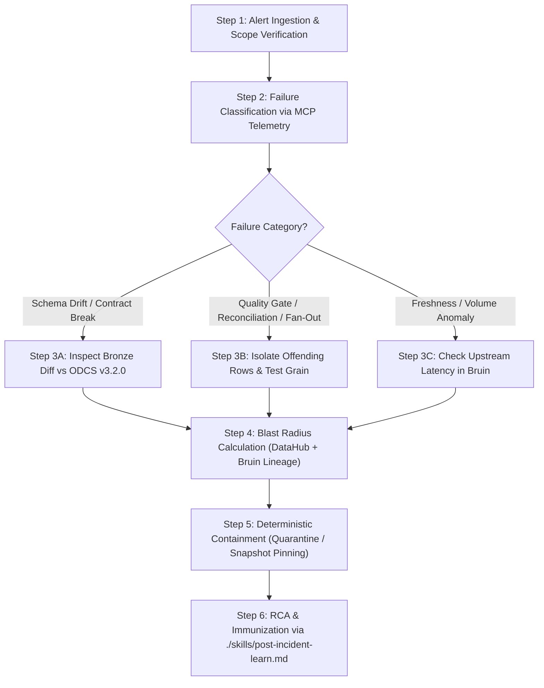

# Deterministic Incident Response Runbook (`INCIDENT_TEMPLATE.md`)

This runbook defines the mandatory deterministic protocol for the `dataops` subagent during Bruin/dbt pipeline failures, ODCS v3.2.0 contract breaches, or data anomalies detected by the `elementary-observability` MCP server.

- **MANDATE**: Execute the 6 steps of the Deterministic Decision Tree below sequentially before invoking open-ended generative reasoning.
- **!ANTI_PATTERN**: Never run destructive re-executions or manually mutate Iceberg/DuckDB tables without completing Steps 1 through 4 and verifying the Severity Matrix.

---

## 1. Data Incident Severity Matrix (P0 – P3)

| Severity | Classification Criteria | Triage SLA | Autonomous Action Allowed (`ALWAYS DO`) | Human Gate (`ASK FIRST`) |
| :--- | :--- | :--- | :--- | :--- |
| **P0 (Critical)** | Silent data corruption in `orders_silver` or Gold FinOps; cleartext PII leak; fan-out distorting `net_order_amount` in production. | < 15 min | Pause downstream DAG in Bruin; isolate offending batch into `_quarantine`; identify last clean Iceberg snapshot. | Production Iceberg snapshot rollback; backfill > 10M rows; external stakeholder notification. |
| **P1 (High)** | Hard-block failure in `datacontract test` or `dbt build` halting `orders_silver` updates beyond the 1h freshness SLA. | < 30 min | Collect Elementary MCP telemetry; compute blast radius in DataHub MCP; draft hotfix PR in an isolated git worktree. | Emergency ODCS v3.2.0 contract modification or manual promotion of quarantined records. |
| **P2 (Medium)** | Volume or distribution anomaly in Elementary (`edr`) without physical contract breach, or delay in non-critical tables. | < 4 hours | Inspect upstream Bronze statistical drift; open detailed RCA diagnostic with recommended threshold/logic adjustment. | Modifying anomaly detection sensitivity thresholds in Elementary. |
| **P3 (Low)** | Deprecation warnings, failures in `dev`/`staging` environments, or transient latency below SLA breach thresholds. | < 24 hours | Log diagnostic summary and propose preventive refactoring via standard PR. | N/A |

---

## 2. Deterministic 6-Step Decision Tree



### Step 1 — Alert Ingestion & Scope Verification
1. Identify the exact failing asset (`bruin_asset_name`, `dbt_model_name`, `contract_id`, and `run_id`).
2. Verify whether the failure occurred in `prod_iceberg_lakehouse` or `local_duckdb`.
3. Assign initial severity (`P0` through `P3`) using the matrix above.

### Step 2 — Deterministic Failure Classification via MCP Telemetry
Inspect telemetry from the `elementary-observability` MCP server and `datacontract test` / `dbt test` logs:
- **Case A (Schema / Contract Drift)**: Missing column, incompatible physical type, or out-of-domain categorical enum value (`order_status` / `payment_status`).
- **Case B (Data Integrity / Financial Reconciliation)**: Primary key uniqueness violation (`duplicateValues > 0` on `order_id`) or accounting identity failure (`net_order_amount`).
- **Case C (Operational / SLA Breach)**: Zero rows in the daily partition (`rowCount == 0`) or freshness lag exceeding 60 minutes on `_ingested_at`.

### Step 3 — Category-Specific Diagnostic
- **If Case A (Schema Drift)**:
  1. Compare the live Bronze schema in `datahub` MCP against `./contracts/orders_silver_v1.odcs.yaml`.
  2. Determine whether it represents a legitimate upstream evolution (e.g., new payment method `BNPL`) or an upstream regression.
- **If Case B (Data Integrity / Fan-Out)**:
  1. Run a Read-Only diagnostic query to isolate duplicated `order_id` keys or financial discrepancies:
     ```sql
     SELECT order_id, COUNT(*) AS row_cnt
     FROM silver_ecommerce.orders_silver
     WHERE order_date = CURRENT_DATE
     GROUP BY order_id
     HAVING COUNT(*) > 1;
     ```
  2. If duplicates exist, inspect the latest git commit across dbt/Bruin models for an unaggregated `JOIN` or accidental removal of `ROW_NUMBER()`.
- **If Case C (SLA / Volume Anomaly)**:
  1. Run `bruin lineage ./pipelines/assets/bronze_orders.sql --full` to identify which upstream ingestion task stalled or failed.

### Step 4 — Blast Radius Calculation (`datahub` MCP + `bruin lineage`)
1. Query column-level lineage in `datahub` MCP starting from the affected table and column.
2. Explicitly list every impacted downstream asset (Gold models, executive dashboards, accounting close exports).

### Step 5 — Deterministic Containment & Safe Recovery
- **If isolated invalid records (< 1% of batch)**: Route offending records to the quarantine table (`silver_ecommerce.orders_silver_quarantine`) while keeping the pipeline healthy for the valid 99%.
- **If systemic partition corruption (P0/P1)**: Request human approval (`ASK FIRST`) presenting the exact Apache Iceberg snapshot rollback command to restore the last verified state prior to the faulty `run_id`.

### Step 6 — Closure & Immunization (Self-Healing Loop)
1. Complete the Post-Mortem Record below.
2. Trigger `./skills/post-incident-learn.md` to convert the root cause into a permanent validation rule in `./contracts/*.odcs.yaml` and `./knowledge/`.

---

## 3. Standardized Post-Mortem Incident Record Template

```markdown
## Incident Report: [INC-YYYY-MM-DD-XXX] — <Short Title>
- **Severity**: P0 | P1 | P2 | P3
- **Affected Contract / Asset**: `urn:datacontract:de-agentic-boilerplate:orders_silver_v1`
- **Detection Source**: Elementary MCP / DataContract CLI / Bruin Orchestrator
- **Time Window (UTC)**: Start `YYYY-MM-DDTHH:MM:SSZ` — Resolved `YYYY-MM-DDTHH:MM:SSZ`
- **Downstream Blast Radius**: [List impacted Gold models and reports via DataHub]

### Root Cause Analysis (Deterministic 5 Whys)
1. **Trigger**: ...
2. **Root Cause**: ...
3. **Why Gate Missed It**: ...

### Remediation & Permanent Guardrail Added
- **Containment Action**: ...
- **Contract / Test Update (`./contracts/`)**: ...
- **Knowledge / Runbook Update (`./knowledge/`)**: ...
```
