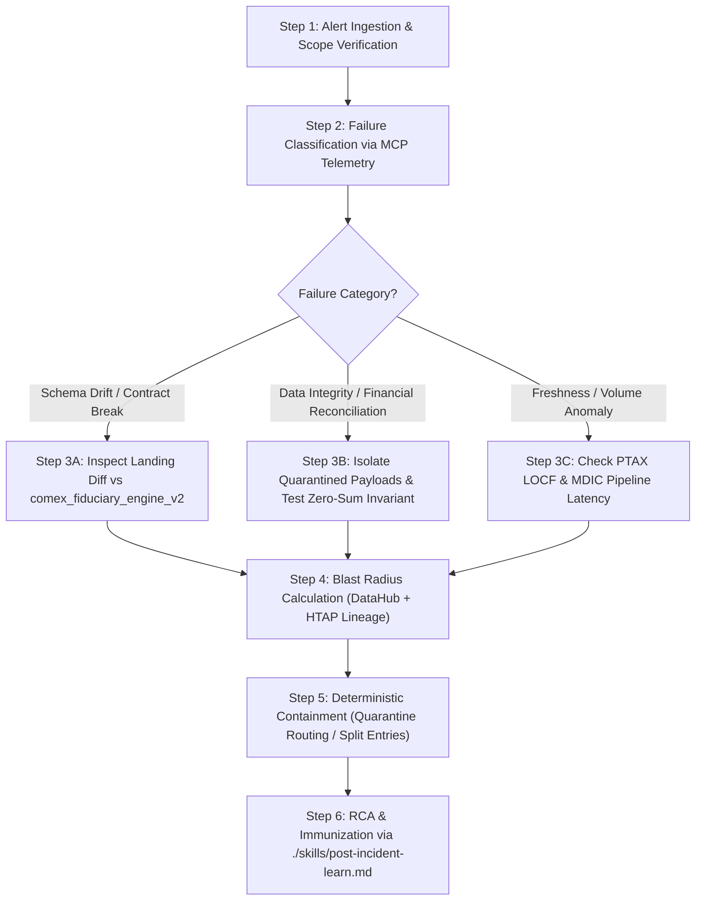

# Deterministic Incident Response Runbook (`INCIDENT_TEMPLATE.md`)

This runbook defines the mandatory deterministic protocol for the `dataops` subagent during ingestion failures, ODCS v3.2.0 data contract breaches (`urn:datacontract:comex:fiduciary_engine_v2`), double-entry balance violations, or anomalies detected across the **Comex Resilient Data & Fiduciary Engine V2 (Profile 2 Hybrid HTAP Medallion)**.

- **MANDATE**: Execute the 6 steps of the Deterministic Decision Tree below sequentially before invoking open-ended generative reasoning.
- **!ANTI_PATTERN**: Never run destructive re-executions, overwrite posted ledger entries in PostgreSQL (`UPDATE`/`DELETE` on `journal_lines`), or mutate Iceberg/DuckDB analytical tables without completing Steps 1 through 4 and verifying the Severity Matrix.

---

## 1. Data Incident Severity Matrix (P0 – P3)

| Severity | Classification Criteria | Triage SLA | Autonomous Action Allowed (`ALWAYS DO`) | Human Gate (`ASK FIRST`) |
| :--- | :--- | :--- | :--- | :--- |
| **P0 (Critical)** | Silent corruption in `journal_entries` / `journal_lines` (double-entry zero-sum invariant violation: $\sum \text{Debit} \neq \sum \text{Credit}$); cleartext natural-person PII leak; corrupted cascading tax or customs valuation in `customs_nationalizations` (distorting statutory ICMS "cálculo por dentro" or duties); fan-out multiplying `landed_cost_brl` in `fact_comex_operations`. | < 15 min | Pause downstream ingestion DAG; trigger DLQ isolation into `comex_quarantine_hitl`; isolate offending batch; identify last clean transactional checkpoint / snapshot. | Production double-entry reversal (`create_reversal_entry`); DuckDB partition rollback; external statutory auditor or Receita Federal notification. |
| **P1 (High)** | Hard-block failure in `datacontract test`, Pydantic V2 validation, or DuckDB build halting `commercial_invoices` or `customs_nationalizations` updates beyond 1h freshness SLA. Deflection of arithmetic mismatches (> 0.0001) to `comex_quarantine_hitl` without auto-resolution. | < 30 min | Collect Elementary MCP telemetry; query quarantine state; compute blast radius in DataHub MCP; draft hotfix PR in an isolated git worktree. | Emergency ODCS v3.2.0 contract modification or manual approval override (`APPROVED_OVERRIDE`) of quarantined records. |
| **P2 (Medium)** | Volume or distribution anomaly in Elementary (`edr`) or MDIC microdata ingestion (`fact_comex_operations`), PTAX currency LOCF gap > 3 business days in `dim_currency_ptax`, or transient delay in non-critical analytical dimensions. | < 4 hours | Inspect upstream Landing/Bronze statistical drift; open detailed RCA diagnostic with recommended threshold/logic adjustment. | Modifying anomaly detection sensitivity thresholds in Elementary or contract rules. |
| **P3 (Low)** | Deprecation warnings, schema comment drift, transient network jitter below SLA breach thresholds, or dev/staging synthetic discrepancies. | < 24 hours | Log diagnostic summary and propose preventive refactoring via standard PR. | N/A |

---

## 2. Deterministic 6-Step Decision Tree



### Step 1 — Alert Ingestion & Scope Verification
1. Identify the exact failing asset:
   - **Operational Ledger / Core (PostgreSQL 16)**: `commercial_invoices`, `journal_entries`, `journal_lines`, `customs_nationalizations`, `comex_quarantine_hitl`.
   - **Raw Landing Zone (MongoDB 7)**: `raw_commercial_invoices`, `raw_swift_statements`, `raw_mdic_declarations`.
   - **Analytical Lakehouse (Parquet / DuckDB)**: `fact_comex_operations`, `dim_currency_ptax`, `dim_merchandise_ncm`, `dim_partner_country`.
2. Identify the contract reference: `urn:datacontract:comex:fiduciary_engine_v2` (`version: 2.0.0`).
3. Assign initial severity (`P0` through `P3`) using the Comex Severity Matrix above.

### Step 2 — Deterministic Failure Classification via MCP Telemetry
Inspect telemetry from `postgres` query tool, `elementary-observability`, and contract validation logs:
- **Case A (Schema / Contract Drift)**: Missing column, incompatible physical type (e.g., IEEE 754 float introduced instead of `NUMERIC(19,4)`), unannounced enum value (`currency_code` not in USD/EUR/CHF/BRL, invalid Incoterm, unrecognized `tax_regime`), or masked corporate tax ID.
- **Case B (Data Integrity / Financial Reconciliation)**:
  - Vertical closure discrepancy: `subtotal_amount + tax_amount + freight_amount + insurance_amount != total_amount` (tolerance > 0.0001).
  - Incoterm coherence violation: `incoterm = 'CIF'` with zero freight or insurance amounts.
  - Double-entry ledger imbalance: $\sum \text{debit\_amount} \neq \sum \text{credit\_amount}$ within `journal_lines`.
  - Duplicate natural key hash: collision on `operation_hash_id` in `fact_comex_operations`.
- **Case C (Operational / SLA & FX Anomaly)**: Missing PTAX daily quotation in `dim_currency_ptax` exceeding LOCF forward-fill thresholds, or zero rows ingested from scheduled MDIC monthly trade declarations.

### Step 3 — Category-Specific Diagnostic

#### If Case A (Schema Drift / Contract Break):
1. Compare the live MongoDB BSON document in `raw_commercial_invoices` or PostgreSQL table schema against `./contracts/comex_fiduciary_engine_v2.odcs.yaml`.
2. Verify strict adherence to monetary precision (`NUMERIC(19,4)`), FX precision (`NUMERIC(19,6)`), and cleartext corporate tax IDs (`issuer_tax_id` CNPJ / Swiss UID).
3. If an unauthorized float type is detected, trace the ingestion parser to ensure `decimal.Decimal` is enforced.

#### If Case B (Data Integrity / Financial Reconciliation):
Run the following Read-Only diagnostic queries to isolate discrepancies:

1. **Inspect Quarantined Ingestion Payloads in `comex_quarantine_hitl`**:
   ```sql
   SELECT quarantine_id,
          source_type,
          raw_payload_hash,
          validation_errors,
          self_correction_attempts,
          review_status,
          created_at
   FROM comex_quarantine_hitl
   WHERE review_status = 'PENDING_REVIEW'
   ORDER BY created_at DESC;
   ```

2. **Verify Double-Entry Zero-Sum Invariant in `journal_lines`**:
   ```sql
   SELECT entry_id,
          SUM(debit_amount) AS total_debit,
          SUM(credit_amount) AS total_credit,
          ABS(SUM(debit_amount) - SUM(credit_amount)) AS balance_diff
   FROM journal_lines
   GROUP BY entry_id
   HAVING ABS(SUM(debit_amount) - SUM(credit_amount)) > 0.0001;
   ```

3. **Verify Grain Uniqueness and Duplicate Keys in `fact_comex_operations`**:
   ```sql
   SELECT operation_hash_id, COUNT(*) AS row_cnt
   FROM fact_comex_operations
   GROUP BY operation_hash_id
   HAVING COUNT(*) > 1;
   ```

4. **Verify Invoice Vertical Math Closure Discrepancies**:
   ```sql
   SELECT invoice_id,
          document_number,
          issuer_tax_id,
          total_amount,
          (subtotal_amount + tax_amount + freight_amount + insurance_amount) AS calculated_total,
          ABS(total_amount - (subtotal_amount + tax_amount + freight_amount + insurance_amount)) AS closure_diff
   FROM commercial_invoices
   WHERE ABS(total_amount - (subtotal_amount + tax_amount + freight_amount + insurance_amount)) > 0.0001;
   ```

#### If Case C (SLA / FX / Volume Anomaly):
1. Inspect `dim_currency_ptax` for stale rates or unmapped dates:
   ```sql
   SELECT date_id, currency_code, ptax_buy_rate, ptax_sell_rate, is_business_day, is_interpolated_locf
   FROM dim_currency_ptax
   WHERE date_id >= CAST(TO_CHAR(CURRENT_DATE - INTERVAL '7 days', 'YYYYMMDD') AS INTEGER)
   ORDER BY date_id DESC, currency_code;
   ```
2. Check upstream ingestion latency in MongoDB landing collections (`raw_commercial_invoices`, `raw_mdic_declarations`).

### Step 4 — Blast Radius Calculation (DataHub MCP + HTAP Lineage)
1. Trace dependency lineage from the affected table/column across HTAP layers:
   - **Landing**: `raw_commercial_invoices` (MongoDB)
   - **Operational Core**: `commercial_invoices` (PostgreSQL)
   - **Fiduciary Ledger**: `journal_entries` $\rightarrow$ `journal_lines` (PostgreSQL)
   - **Customs & Tax**: `customs_nationalizations` (PostgreSQL)
   - **Analytical Mart**: `fact_comex_operations` (DuckDB / Parquet)
   - **Downstream Consumers**: CPC 16 inventory landed cost valuation, statutory tax reports (DIRF/Siscomex), executive margin dashboards.
2. Quantify exposure: count of unposted journal entries, delayed customs clearances, or affected fiscal periods.

### Step 5 — Deterministic Containment & Safe Recovery
- **If isolated invalid payloads (< 1% of batch)**:
  - Route malformed or mathematically inconsistent records immediately to `comex_quarantine_hitl` with `review_status = 'PENDING_REVIEW'`, preserving `mongo_raw_id` for visual auditing via MongoDB Compass.
  - Allow valid invoices in the batch to proceed seamlessly into `commercial_invoices` and downstream posting.
- **If arithmetic discrepancy cannot be resolved deterministically**:
  - **MANDATE**: Autonomous agents must NEVER hallucinate or force-balance financial totals. Keep the record in `PENDING_REVIEW` or mark `REJECTED`, alerting the foreign exporter to supply a formal credit note or corrected invoice.
- **If Incoterm CIF is missing freight/insurance breakdown on invoice face**:
  - Human auditor inspects the attached Bill of Lading (B/L) and Insurance Certificate via MongoDB Compass. Upon verifying external logistics figures, the auditor submits an `APPROVED_OVERRIDE` recording `reviewed_by` and updating the itemized breakdown.
- **If systemic posted ledger corruption (P0)**:
  - Request human approval (`ASK FIRST`) to execute statutory compensating entries via `create_reversal_entry`. Never issue direct SQL `UPDATE` or `DELETE` statements against `journal_lines`.

### Step 6 — Closure & Immunization via `./skills/post-incident-learn.md`
1. Complete the Standardized Post-Mortem Incident Record below.
2. Execute the 5-step learning workflow from `./skills/post-incident-learn.md` to harden `./contracts/comex_fiduciary_engine_v2.odcs.yaml`, update `./knowledge/domain/semantic_rules.md`, and add regression tests.

---

## 3. Standardized Post-Mortem Incident Record Template

```markdown
## Incident Report: [INC-YYYY-MM-DD-XXX] — <Short Title>
- **Severity**: P0 | P1 | P2 | P3
- **Affected Contract / Asset**: `urn:datacontract:comex:fiduciary_engine_v2` / `<table_or_collection_name>`
- **Detection Source**: Pydantic V2 / DataContract CLI / PostgreSQL Invariant / Elementary MCP
- **Time Window (UTC)**: Start `YYYY-MM-DDTHH:MM:SSZ` — Resolved `YYYY-MM-DDTHH:MM:SSZ`
- **Downstream Blast Radius**: [List impacted tables: journal_entries, customs_nationalizations, fact_comex_operations, Gold Dashboards]

### Incident Summary
[Brief description of the incident and operational symptoms]

### 6-Step Decision Tree Execution Trace
- **Step 1 (Ingestion & Scope)**: ...
- **Step 2 (Classification)**: ...
- **Step 3 (Diagnostic SQL)**: ...
- **Step 4 (Blast Radius)**: ...
- **Step 5 (Deterministic Containment)**: ...
- **Step 6 (Immunization)**: ...

### Root Cause Analysis (Deterministic 5 Whys)
1. **Trigger**: ...
2. **Immediate Cause**: ...
3. **Underlying Mechanism**: ...
4. **Why Guardrail / Gate Missed It**: ...
5. **Systemic Root Cause**: ...

### Remediation & Permanent Guardrail Added
- **Containment Action Taken**: ...
- **Quarantine Lifecycle Action**: `APPROVED_OVERRIDE` | `REJECTED` | `PENDING_REVIEW`
- **Contract / Test Update (`./contracts/`)**: ...
- **Knowledge / Runbook Update (`./knowledge/`)**: ...
- **Audit Verification Hash**: ...
```
